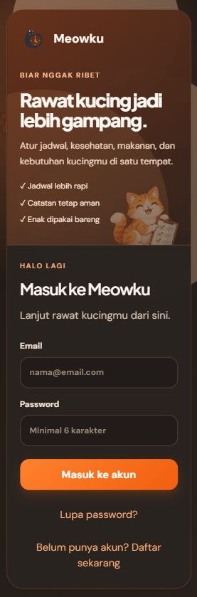

# Meowku

Meowku adalah aplikasi web untuk membantu perawatan kucing di rumah tetap rapi, terjadwal, dan mudah dikerjakan bersama.



## Sekilas

Meowku menyatukan jadwal perawatan, checklist harian, histori aktivitas, data kucing, kebutuhan litter box, katalog, laporan, anggota rumah, dan pengaturan dalam satu ruang kerja.

Fokusnya sederhana: setiap tugas punya jadwal yang jelas, bisa ditugaskan, diselesaikan, dan tetap terlacak tanpa membuat rutinitas perawatan terasa rumit.

## Fitur utama

- Dashboard checklist perawatan harian.
- Jadwal berulang dengan slot waktu, rentang tanggal, kategori, target, dan petugas.
- `Jadwal saya` untuk melihat tugas berdasarkan hari, minggu, bulan, dan kategori.
- Preview tugas berikutnya untuk persiapan hari berikutnya.
- Data kucing dan cat-care: kesehatan, vaksinasi, makanan, pengeluaran, dan catatan.
- Manajemen litter box, katalog, anggota rumah, histori, laporan, dan export.
- Tema terang/gelap, bahasa Indonesia/Inggris, layout responsif, dan dukungan PWA.
- Notifikasi web dengan status kesiapan yang jujur ketika HTTPS atau konfigurasi push belum tersedia.

## Teknologi

React, Vite, TypeScript, TanStack Router, TanStack Query, Tailwind/shadcn-style components, dan Supabase Auth/Postgres/RLS/Edge Functions.

Data bisnis aplikasi berasal dari Supabase. Tidak ada data contoh atau kredensial produksi di README ini.

## Menjalankan secara lokal

```bash
npm install
cp .env.example .env
npm run dev
```

Isi `.env` dengan konfigurasi Supabase milik lingkungan lokal atau project kamu sendiri. Jangan commit `.env`, service-role key, password database, private VAPID key, atau secret Edge Function.

Untuk pemeriksaan lokal:

```bash
npm test
npm run typecheck
npm run build
```

Instalasi PWA dan push notification pada HP membutuhkan alamat HTTPS yang dipercaya perangkat. `http://localhost` hanya menjadi pengecualian pada perangkat yang menjalankan server.

## Status

Project ini disiapkan untuk pengembangan dan pengujian lokal. Konfigurasi backend, akun, dan data operasional sengaja tidak dipublikasikan di README.
